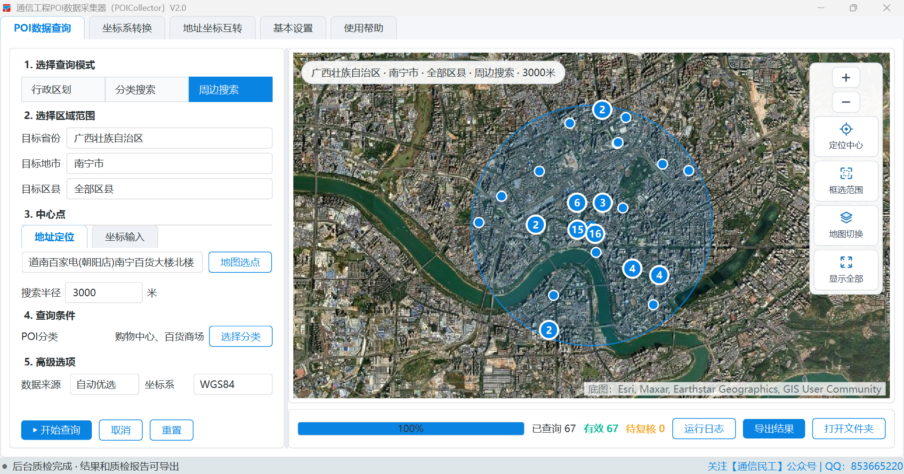

# 通信工程 POI 数据采集器 · POICollector

POICollector — Telecom Engineering POI Data Collector

一款面向通信规划、无线优化、网络建设和维护人员的桌面 GIS 数据工具。软件集成行政区划采集、分类 POI 搜索、周边搜索、地址坐标互转、坐标系转换、交叉校验和规范 Excel 导出，并通过地图工作台直观呈现查询范围与点位结果。

A desktop GIS data tool for telecom planning, RF optimization, network construction, and maintenance. It combines administrative-division collection, category-based POI search, nearby search, geocoding, coordinate conversion, quality validation, map visualization, and structured Excel export.

> ⚠️ **界面语言 / UI Language**：软件界面为简体中文（Simplified Chinese only）。英文读者可通过本 README 了解功能、安装方式和数据安全要求。

---

## ✨ 主要功能及特点 / Features



### 查询与数据处理 / Query and Data Processing

| 功能 Feature | 说明 Description |
|---|---|
| 行政区划 Administrative Divisions | 按省、市、区县、乡镇和行政村层级采集区划名称、编码、驻地地址及坐标。 |
| 分类搜索 Category Search | 按省、市、区县和一个或多个 POI 分类分页查询，不要求额外输入关键字。 |
| 周边搜索 Nearby Search | 支持地图中心、坐标输入和框选范围，按半径与分类查询附近 POI。 |
| 地址坐标互转 Geocoding | 支持地址转经纬度、经纬度反查地址及批量表格处理。 |
| 坐标转换 Coordinate Conversion | 支持 WGS84、GCJ-02、BD-09 等常用坐标系转换。 |
| 质量校验 Quality Control | 校验坐标范围、行政区归属、数据完整性、数据来源和置信度。 |
| Excel 导出 Excel Export | 输出结构化工作表、规范字段、表头样式和质检信息。 |

### V2.0 重点增强 / Key Enhancements

- **纯 Qt 地图 Pure Qt Map**：PySide6 原生绘制与 QtNetwork XYZ/TMS 瓦片，不依赖 QtWebEngine、Chromium 或浏览器运行时。
- **多图源底图 Multiple Basemaps**：支持 ArcGIS、OpenStreetMap、天地图及用户自定义 XYZ/TMS 图源。
- **服务解耦 Service Decoupling**：POI 查询 KEY 与地图显示配置独立管理，底图异常不终止业务查询。
- **自动换源 Automatic Fallback**：查询源或底图不可用时，可按设置的优先级切换备用服务。
- **大数据处理 Large Datasets**：使用分页任务、SQLite 流式暂存、可取消工作线程和有限地图绘制，降低大规模任务的内存与界面压力。
- **安全存储 Secure Storage**：地图服务 KEY 使用 Windows DPAPI 加密，保存于当前用户本机配置目录，不写入源码或 EXE。
- **结果即刻呈现 Immediate Results**：检索结果直接生成地图点图层并开放导出，后台交叉质检不阻塞结果查看。

---

## 📁 支持格式 / Supported Formats

| 场景 Scenario | 输入 Input | 输出 Output |
|---|---|---|
| 坐标转换 | XLSX、XLS、CSV | XLSX |
| 地址坐标互转 | XLSX、XLS、CSV | XLSX |
| 行政区划与 POI 查询 | 软件表单及地图范围 | XLSX、地图点图层、质检信息 |

输入表格第一行应为字段名称。批量处理前建议先用少量记录核对字段映射、行政区和坐标系。

---

## 🚀 快速开始 / Quick Start

### 下载程序 / Download

不需要 Python 环境的 Windows x64 用户，可从 [POICollector V2.0 发布页](https://github.com/xuworker98/POICollector/releases/tag/v2.0.0) 下载 EXE 程序。

- 适用系统：Windows 10/11 x64
- 文件大小：54.38 MB
- SHA-256：`43478F41DD0D396D35758E82D34E14DC91F16D5BF5C522DEA602414662E69CB4`
- 签名说明：当前 EXE 未进行代码签名，Windows 可能显示“未知发布者”，请从本项目官方 Release 页面下载并核对 SHA-256。

### 运行环境 / Requirements

- Windows 10/11 x64
- Python 3.12
- PySide6 6.x

### 安装与运行 / Install and Run

```powershell
git clone https://github.com/xuworker98/POICollector.git
cd POICollector
python -m venv .venv
.\.venv\Scripts\Activate.ps1
python -m pip install -r requirements.txt
python main.py
```

也可以运行项目脚本：

```powershell
.\scripts\run.ps1
```

首次运行后，请在“基本设置”中填写自己的地图服务端 KEY、测试连接并设置查询源优先级。仓库不提供任何公共或测试 KEY。

---

## 🧪 开发者 / For Developers

### 自动测试 / Tests

```powershell
$env:QT_QPA_PLATFORM = 'offscreen'
python -m pytest -q
```

当前版本包含单元、集成、数据流和 GUI 布局测试。公开源码发布前已通过完整测试集。

### 构建单文件 EXE / Build

```powershell
python -m pip install -r requirements-build.txt
.\scripts\build.ps1
```

构建输出位于 `output\package\POICollector_V2.0.exe`。Miniforge 将 SQLite 运行库放在非标准目录，`POICollector.spec` 会显式检查并打包该 DLL；使用其他 Python 发行版时可能需要调整相应路径。

### 区划种子数据 / Division Seed Data

如需从已核验工作簿重新生成离线区划数据：

```powershell
python .\scripts\build_reference_seed.py "D:\path\to\行政区划数据.xlsx"
```

请确保输入数据具有合法来源和发布权限。

---

## 🏗️ 技术栈 / Tech Stack

Python 3.12 · PySide6 · QtNetwork · OpenPyXL · PyProj · SQLite · Requests · PyYAML · PyInstaller

---

## 📂 目录结构 / Project Structure

```text
.
├── data/                  分类、区划和村级静态基础数据
├── scripts/               启动、测试、构建和数据维护脚本
├── src/poi_collector/     应用源代码及必要界面资源
├── tests/                 自动化测试
├── main.py                程序入口
├── POICollector.spec      PyInstaller 构建配置
└── requirements.txt       运行依赖
```

---

## 🔐 KEY 与数据安全 / Security

- 仓库不包含天地图、高德、百度、腾讯或其他平台的 API KEY。
- 请勿提交 `config.yaml`、`keys.dpapi`、`.env`、访问令牌、私钥或账号凭据。
- 请勿提交运行日志、SQLite 断点库、查询结果或未经脱敏的地址与坐标数据。
- 若密钥曾进入 Git 历史，仅删除当前文件并不安全，应立即到对应平台撤销并重新申请。
- 请遵守地图平台调用配额、数据许可、底图署名和服务条款。

---

## 📄 授权说明 / License

本仓库当前未附开放源代码许可证。除法律另有规定外，代码默认保留全部权利；公开可见不代表获得复制、修改或再分发授权。

No open-source license is currently granted. Unless otherwise required by law, all rights are reserved. Public visibility does not constitute permission to copy, modify, or redistribute the code.

---

## 📞 联系方式 / Contact

- **作者 Author**：通信民工（Jerry Xu）
- **哔哩哔哩 Bilibili**：@通信民工（UID：482597398）
- **微信公众号 WeChat**：@通信民工（ComDesigner）
- **QQ**：853665220（@qq.com）
- **网站 Website**：[http://www.txmg.com](http://www.txmg.com)
- **著作 Book**：《5G网络规划与工程实践》（清华大学出版社出版，当当、京东、淘宝等平台均可购买）

### 微信公众号二维码 / WeChat QR Code

扫描下方二维码关注微信公众号“通信民工（ComDesigner）”。

Scan the QR code below to follow the WeChat official account “通信民工（ComDesigner）”.

[微信公众号二维码 / WeChat QR Code](https://github.com/xuworker98/PlanLayerCreator/blob/master/res/qrcode.jpg)


---

## 🐞 问题反馈 / Issues

请通过 [GitHub Issues](https://github.com/xuworker98/POICollector/issues) 提交问题。请附软件版本、操作系统、复现步骤和少量脱敏样例；不要公开 API KEY、个人地址或受限制数据。
